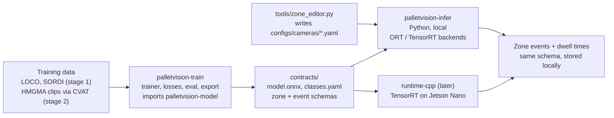

# HMGMA Pallet Vision — Design

> Training and inference design for pallet detection, tracking and zone analytics at HMGMA.
> Status: draft, 2026-10-06. Source of truth for discussion is the lab design doc; this file tracks it for the repo.

## TL;DR

One monorepo. A clean-room PyTorch reimplementation of YOLO26 is trained per frame, a tracker links detections into pallet IDs, and a zone engine turns tracks into events (entered, dwelled, left, moved A → B). Python owns training and local video inference; a C++/TensorRT runtime is added later behind the same ONNX + config contract.

- **"Video detection" = detection + tracking.** The detector is trained on frames sampled from video; a tracker (ByteTrack / OC-SORT, no training) assigns IDs. Nothing temporal is learned in v1.
- **Two training stages.** Stage 1 learns one class, `pallet` (where is a pallet). Stage 2 fine-tunes on HMGMA footage to classify `pallet_type_a/b/c` (+ `pallet_unknown`).
- **We own the model code.** Ultralytics code and weights are AGPL-3.0, and an embedded sponsor deployment would need an Enterprise licence. We do not import or copy Ultralytics and do not start from its weights.
- **Target edge board: original Jetson Nano (4 GB)** → JetPack 4.6.x, TensorRT 8.2, YOLO26n only, FP16.
- **No cloud for sponsor data.** HMGMA footage stays on lab-controlled storage and compute.

## How the pipeline works

Per camera, at runtime:

1. **Decode** the stream (file or RTSP) at a fixed rate, e.g. 10 fps (pallets move slowly).
2. **Detect** each frame with YOLO26: boxes + pallet type + confidence. NMS-free, so latency is constant with pallet count.
3. **Track**: Kalman filter + IoU association (ByteTrack / OC-SORT) assigns a stable track ID. Class-agnostic.
4. **Type vote**: a track's type is the confidence-weighted vote over all its frames, so one bad frame can't flip A ↔ B.
5. **Zones**: each track's ground-contact point is tested against zone polygons; a state machine emits enter / exit / transition events.
6. **Emit** events and dwell times to local storage.

| Component | Learned? | What it needs |
| --- | --- | --- |
| Detector (YOLO26) | Yes — stage 1 + stage 2 | Frames with boxes (COCO format) |
| Tracker (ByteTrack / OC-SORT) | No — hyper-parameters only | Labelled clips with IDs (MOT format) to tune and score |
| Re-ID embedding (optional, v2) | Yes | Only if IDs keep swapping under occlusion |
| Zone engine | No | Polygons per camera + dwell thresholds |
| Activity model / VLM (v3) | Yes | Clip-level labels (loading, unloading, dropped) |

Label **clips** with track IDs, not isolated images: one clip yields detector frames (every Nth frame) and tracker ground truth.

## Architecture



Training only produces artefacts in `contracts/`. Both runtimes consume them and must emit identical events on the golden clip.

## Repo layout

```text
hmgma-pallet-vision/
├── pyproject.toml            # uv workspace root
├── docs/DESIGN.md            # this file
├── contracts/                # single source of truth, versioned
│   ├── model_io.yaml         # input size, normalisation, output tensor names/shapes
│   ├── classes.yaml          # stage-1: pallet; stage-2: pallet_type_a/b/c, pallet_unknown
│   ├── zones.schema.json     # JSON Schema for per-camera zone files
│   └── events.schema.json    # enter / exit / transition event records
├── configs/                  # Hydra: model/, data/, train/, track/, cameras/
│   ├── train/stage1_pallet.yaml
│   ├── train/stage2_types.yaml
│   └── cameras/cam01.yaml
├── packages/
│   ├── palletvision-model/   # pure nn.Modules: blocks, backbone, neck, head, losses, assigner
│   ├── palletvision-train/   # datasets, augment, trainer, eval, export_onnx
│   └── palletvision-infer/   # video IO, detector backends, tracker, zones, events, overlay
├── runtime-cpp/              # later: TensorRT engine, tracker + zones port, GStreamer IO
│   ├── CMakeLists.txt
│   └── src/  include/  tests/
├── tools/
│   ├── zone_editor.py        # click polygons on a reference frame → configs/cameras/*.yaml
│   ├── cvat_to_coco.py  cvat_to_mot.py  sample_frames.py
├── data/                     # DVC pointers only; raw footage stays on lab storage
├── experiments/              # one short README per experiment
├── tests/                    # contract + golden-output tests across packages
└── docker/                   # train (x86 CUDA) and jetson (L4T r32.7) images
```

Rules that let it scale to C++:

- **`palletvision-model` imports only `torch`.** No training or I/O code, so it exports cleanly and can be swapped behind a `Detector` interface (e.g. a DETR fallback).
- **Pluggable backends** in `palletvision-infer`: `TorchBackend` (debug), `OnnxRuntimeBackend` (local default), `TensorRTBackend` (Jetson). All return the same `Detections` dataclass.
- **Golden tests:** a ~20 s reference clip with known tracks and events. Every backend, and later the C++ runtime, must reproduce them within tolerance.
- **Tracker and zone engine are plain numpy**, so the C++ port is a translation, not a redesign.

## Model: YOLO26 in plain PyTorch

Reimplemented from the public design ([docs](https://docs.ultralytics.com/models/yolo26/), [yolo26.yaml](https://github.com/ultralytics/ultralytics/blob/main/ultralytics/cfg/models/26/yolo26.yaml), [analysis paper](https://arxiv.org/html/2601.12882v1)), not copied:

- **Backbone:** strided `Conv` stem → `C3k2` CSP blocks at P2–P5 → `SPPF` → `C2PSA` (attention) at P5.
- **Neck:** PAN, outputs P3/8, P4/16, P5/32.
- **Head:** decoupled cls / box branches, `reg_max = 1` (no DFL, direct box regression), end-to-end.
- **NMS-free:** one-to-one head at inference; a one-to-many head adds dense supervision during training only.
- **Training:** ProgLoss, STAL (small-target-aware assignment), MuSGD optimiser.

### n vs s

Same layers and depth (0.50); s is twice as wide (width 0.25 vs 0.50 → P3/P4/P5 channels 64/128/256 vs 128/256/512). Conv cost scales with $C_{\text{in}} \cdot C_{\text{out}}$, so s costs ~4× the compute.

| Size | Params (M) | FLOPs (B) | COCO mAP50-95 | mAP50-95 (e2e, NMS-free) | T4 TensorRT (ms) |
| --- | --- | --- | --- | --- | --- |
| YOLO26n | 2.4 | 5.5 | 40.9 | 40.1 | 1.7 |
| YOLO26s | 9.5 | 20.9 | 48.6 | 47.8 | 2.5 |

The e2e column is the one we deploy. COCO has 80 classes and many tiny objects; with 1–4 classes of large pallets expect higher scores and a smaller n–s gap. **Deploy n on the Jetson Nano**; train s as well to check whether width helps type classification.

### Licensing (not legal advice — confirm with the lab / GT)

- No `pip install ultralytics` in the deployable path; no copied Ultralytics source; no Ultralytics `.pt` weights.
- Ultralytics may be used only as an external benchmark in a separate, non-shipped environment.
- ByteTrack, OC-SORT, TrackEval, CVAT are MIT. BoxMOT is AGPL — reimplement the tracker instead.
- Fallback detectors with Apache-2.0 licences: [D-FINE](https://github.com/Peterande/D-FINE), [RF-DETR](https://github.com/roboflow/rf-detr).

## Training stages and where each runs

| Stage | What | Data | Init from | Where it runs |
| --- | --- | --- | --- | --- |
| 0 | Verify the reimplementation | COCO subset (public) | scratch | RunPod / PACE (Mac too slow for full COCO) |
| 1 | Single-class `pallet` detector | LOCO + SORDI subset (public), all pallet-like labels → `pallet` | stage 0 or ImageNet backbone | RunPod 4090 (~2–4 h) or PACE; Mac overnight (~9–14 h for n) |
| 2 | **Type fine-tune** A / B / C / unknown | HMGMA clips (sponsor, NDA) | stage 1 checkpoint | **Lab machine or PACE only** (Mac only if the NDA allows footage on a laptop). Never RunPod / cloud |
| 3 | Tracker + zone tuning | Labelled HMGMA clips (MOT) | — | Same as stage 2; CPU is enough |

### How stage 2 fine-tunes

- Load the stage-1 checkpoint; keep backbone, neck and box branch.
- Replace only the classification output: 1 → 4 classes.
- Freeze the backbone for the first epochs, lower LR, then unfreeze.
- Train at deployment resolution (640; 512 if the Nano can't keep up).

```bash
uv run pv-train +train=stage2_types \
    model=yolo26n \
    init.checkpoint=runs/stage1/best.pt \
    data=hmgma_types \
    train.freeze=backbone train.freeze_epochs=5 \
    device=cuda   # or mps on the Mac
```

### Compute estimates (rough, ±2×; replace with a one-epoch benchmark)

Training time $t \approx \dfrac{N_{\text{images}} \times N_{\text{epochs}}}{\text{throughput}}$.

| Run | Data × epochs | M5 Pro 20-core GPU, n | M5 Pro, s |
| --- | --- | --- | --- |
| Stage 0, COCO subset | 10k × 100 | ~4–6 h | ~10–15 h |
| Stage 1 | ~25k × 100 | ~9–14 h | ~1–1.5 days |
| Stage 2 | ~5k × 50 | ~1–1.5 h | ~2–4 h |

Mac notes: PyTorch MPS backend, set `PYTORCH_ENABLE_MPS_FALLBACK=1`, fp16 autocast only, no DDP; `torch.compile` gives little. Keep `device` a config value so runs move between Mac, RunPod and PACE unchanged.

## Datasets

| Dataset | Type | Gives us | Role |
| --- | --- | --- | --- |
| [LOCO](https://github.com/tum-fml/loco) | Real, 5,593 labelled images, COCO | Pallets, pallet trucks, forklifts, stillages | Stage 1 |
| [SORDI](https://sordi.ai) | Synthetic (Omniverse), 1.2M+ images | Industrial logistics objects | Stage 1 volume + domain randomisation |
| Synapse (Isaac Sim) | Synthetic warehouse | 2D/3D boxes, masks | Optional |
| COCO / Objects365 subset | Real, general | Generic features | Stage 0 only |
| **HMGMA footage** | Real, sponsor-owned | Target domain | Stage 2, tracker tuning, all final evaluation |

HMGMA labelling plan:

1. 30–60 clips of 1–2 min across Zones 1–3, shifts, lighting and all three vendors. Split train/val/test **by clip (ideally by day)**, never by frame.
2. Self-hosted CVAT, track mode: keyframes + interpolation; one ID per physical pallet.
3. Pallet type is a **track attribute** set once per track.
4. Export COCO (every Nth frame, detector) and MOT 1.1 (all frames, TrackEval) from the same labels.
5. Use each new model to pre-label the next batch.

## Zones

Polygons in image pixels, drawn once per camera on a reference frame with `tools/zone_editor.py`, validated against `contracts/zones.schema.json`:

```yaml
camera_id: cam01
reference_frame: refs/cam01_2026-10-20.png   # re-draw if the camera is bumped
image_size: [1920, 1080]
zones:
  - id: zone_1_unloading
    polygon: [[112, 980], [860, 940], [910, 610], [240, 620]]
    min_dwell_s: 5
  - id: zone_2_transfer
    polygon: [[930, 960], [1800, 1000], [1700, 640], [950, 600]]
    min_dwell_s: 2
```

Per track:

- Membership = bottom-centre of the box (ground-contact point) inside the polygon.
- Hysteresis: inside for $k$ consecutive frames to enter, outside for $k$ to exit.
- Events: `track_id, pallet_type, zone_id, t_enter, t_exit` plus `transition` events (`zone_1 → zone_2`).
- A lost track re-appearing at the same spot within a short window is merged (cheap ID-switch fix).
- Later: per-camera homography → zones in floor coordinates (fusion with the Task 1 digital twin).

## Edge target: original Jetson Nano

JetPack 4.6.x (L4T r32.7): Ubuntu 18.04, CUDA 10.2, TensorRT 8.2, Python 3.6.

- **YOLO26n, TensorRT FP16.** Maxwell GPU: no INT8 speed-up. 640 input; drop to 512/416 if a stream can't hold ~10 fps.
- **ONNX opset 13** (TensorRT 8.2 parser limit). Build a test engine on the Nano during M1: the NMS-free head's top-k/gather and C2PSA attention are the likeliest to need workarounds.
- **No modern PyTorch on device.** On-device Python uses TensorRT's Python bindings.
- **4 GB shared memory:** 1–2 camera streams per Nano, hardware decode via GStreamer `nvv4l2decoder`.
- **C++ runtime:** L4T r32.7 container, GCC 7, C++17 (`-lstdc++fs` for `std::filesystem`), CMake, yaml-cpp, spdlog, GoogleTest.
- Contracts are board-agnostic: moving to an Orin-class board later is a rebuild, not a redesign.

## Tech stack

| Layer | Choice |
| --- | --- |
| Env | Python 3.11, `uv` workspace, committed lockfile |
| Model / training | PyTorch 2.x, AMP, DDP (CUDA only) |
| Config | Hydra + OmegaConf with dataclass schemas |
| Augmentation | Albumentations + in-repo mosaic |
| Experiment tracking | MLflow (self-hosted) or W&B offline |
| Data versioning | DVC on lab storage |
| Labelling | CVAT, self-hosted |
| Metrics | pycocotools (mAP), TrackEval (HOTA, IDF1) |
| Zones / overlay | Shapely, OpenCV, optionally supervision |
| Quality | ruff, mypy, pytest, pre-commit, CI on CPU |
| Export | `torch.onnx.export` opset 13 + ONNX Runtime parity test |
| Edge | TensorRT 8.2, CUDA 10.2, GStreamer, C++17 |

## Evaluation

| Level | Metric | Tool |
| --- | --- | --- |
| Detector | mAP50, mAP50-95, per-class AP | pycocotools |
| Type | Per-type accuracy, confusion matrix (A/B/C/unknown), track-level after voting | own script |
| Tracker | HOTA, IDF1, ID switches per minute | TrackEval |
| System | Zone-event precision/recall, dwell-time error (s) vs hand-timed truth | `tests/` |
| Edge | fps per camera, p99 latency | `tegrastats` + timer |

mAP50-95 averages mAP over IoU thresholds $t \in \{0.50, 0.55, \dots, 0.95\}$, where $\text{IoU} = \frac{|B_{\text{pred}} \cap B_{\text{gt}}|}{|B_{\text{pred}} \cup B_{\text{gt}}|}$. The sponsor-facing number is dwell-time error, not mAP.

## Milestones

1. **M0 — Skeleton.** uv workspace, contracts, configs, CI. *Gate:* tests green; dummy model exports to ONNX.
2. **M1 — YOLO26 reimplemented.** Model, loss, assigner, trainer; test TensorRT 8.2 engine on the Nano. *Gate:* n on COCO subset tracks the published curve; engine builds.
3. **M2 — Stage 1 pallet detector.** *Gate:* LOCO pallet AP reported.
4. **M3 — Local Python pipeline.** Video → tracker → zones → events + annotated video. *Gate:* golden clip passes.
5. **M4 — Stage 2 type fine-tune.** *Gate:* type accuracy, HOTA and dwell-time error on held-out HMGMA clips.
6. **M5 — Edge.** TensorRT Python backend on the Nano, then C++ runtime. *Gate:* C++ matches Python on the golden clip at target fps.

M0–M3 need no sponsor data.

## Open questions

- [x] Edge board — original Jetson Nano (answered 2026-10-06).
- [ ] Cameras per device, resolution, fps; fixed-mount?
- [ ] Footage delivery date, format, timestamps.
- [ ] What visually distinguishes pallet types A/B/C at working distance?
- [ ] Licensing position with GT / sponsor (own reimplementation vs Ultralytics Enterprise).
- [ ] Is the VLM / activity direction still in scope for v1?
- [ ] Training compute for sponsor data: lab server or PACE allocation? Is footage allowed on personal laptops?
