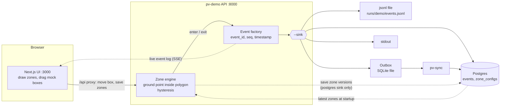
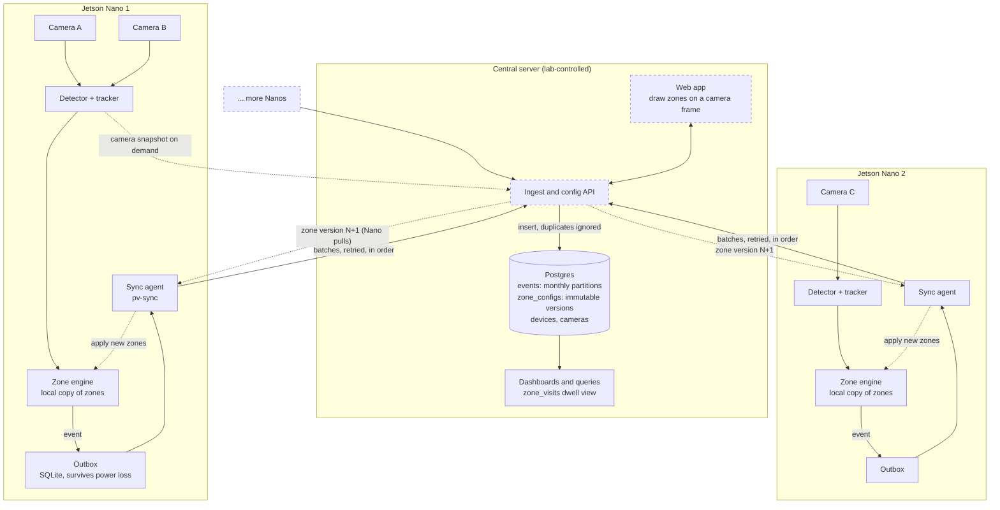

# After inference: from bounding box to stored event

What happens once the detector has drawn a box. The first diagram is the local demo; the second is the production setup with many Nanos and cameras. Boxes and lines drawn dashed are **not built yet**.

Related: [README](../README.md) for how to run things, [design.md](design.md) for the full design, especially *Events and distributed storage*.

## Local: the demo on a laptop

The mock boxes you drag in the browser stand in for the detector and tracker.

- **`--sink`** picks where events are stored: `jsonl` (default), `postgres`, `outbox` or `stdout`. A *sink* is simply the destination an event is handed to; the engine does not care which one it is.
- **The browser's event log** shows events whatever the sink is, because events are also pushed straight to the page.
- **Zones** are saved to and loaded from Postgres only with `--sink postgres`. With any other sink they exist for the session only.
- **`outbox` + `pv-sync`** mimics a Jetson: events are queued locally and forwarded to Postgres later, once each.

## Production: many Nanos and cameras

- **A Nano never talks to Postgres.** It writes each event to its local outbox, and the sync agent sends batches to the central API. A failed send is retried, so an outage delays events but loses none.
- **Resends are harmless.** Every event has an id made on the Nano, so the database ignores duplicates. A per-device `seq` counter exposes any gaps.
- **Zones flow the other way.** Someone draws zones in the web app, the API stores a new immutable version, and each Nano pulls the version for its cameras and applies it. The Nano keeps its last applied version, so it keeps working offline.
- **Why Nanos pull:** factory networks usually allow outbound connections but not inbound ones, and a pull needs no open ports or device addresses.

## What exists today

| Piece | Status |
| --- | --- |
| Zone engine (plain Python, golden-tested for a later C++ port) | Built |
| Event records, outbox, `pv-sync`, Postgres `events` table, `zone_visits` view | Built |
| Versioned `zone_configs` in Postgres, loaded and saved by the demo | Built |
| Browser demo: draw zones, drag mock boxes, live event log | Built |
| `pv-sync` writing events to Postgres | Built, directly to the database for now |
| Ingest and config API between Nanos and Postgres | Not built |
| Production web app with a real camera frame | Not built |
| Nano pulling and applying zone versions, acknowledgements | Not built |
| Camera snapshot on demand, live preview | Not built |
| Real detector and tracker feeding the engine | Not built |
