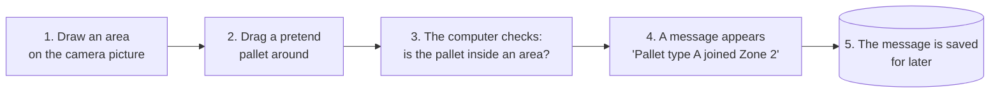
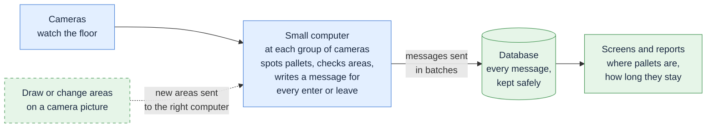

# What happens after the camera spots a pallet

The system watches camera video, finds pallets, and records when a pallet **enters** or **leaves** a marked area of the floor. This page shows that last part in two pictures: a version you can try today on a laptop, and the version planned for the factory floor.

Dashed boxes are **not built yet**.

## Try it today: on a laptop

There is no real camera in this version. You draw the areas yourself and drag a pretend pallet around to see what the system records.

What you see on screen: the camera picture, your drawn areas, the pretend pallet, and a running list of messages like *"Pallet type A left Zone 1"*.

## In the factory: many cameras, many small computers

Each small computer sits near its cameras. It does the watching and decision-making on the spot, then sends short messages to the office server. Staff draw the areas once on a picture from the camera.

**Blue** is on the factory floor, **green** is in the office. The dashed box and arrow are the part still to be built: when someone changes an area in the office, the new version is sent to the right small computer automatically.

## Why it is built this way

- **Nothing gets lost.** If the network drops, each small computer keeps its messages and sends them when the connection is back.
- **Nothing is counted twice.** Every message has its own ID, so a resend never creates a duplicate.
- **Every change is traceable.** Each time an area is redrawn it is saved as a new numbered version, never overwritten. Any past message can be checked against the exact areas that were in place at that moment.
- **Cameras keep working on their own.** The decisions happen at the small computer, so a slow office network does not slow down detection.

## Where things stand

| | Status |
| --- | --- |
| Drawing areas and dragging a pretend pallet on a laptop | Works |
| Recording enter and leave messages | Works |
| Saving messages and area versions in a database | Works |
| Sending messages from a small computer, safely, in batches | Works |
| Real pallet detection feeding the system | Next |
| Office screen for drawing areas on a real camera picture | Next |
| Sending changed areas out to each small computer | Next |

For the technical version, see [design.md](design.md) (section *Events and distributed storage*).
